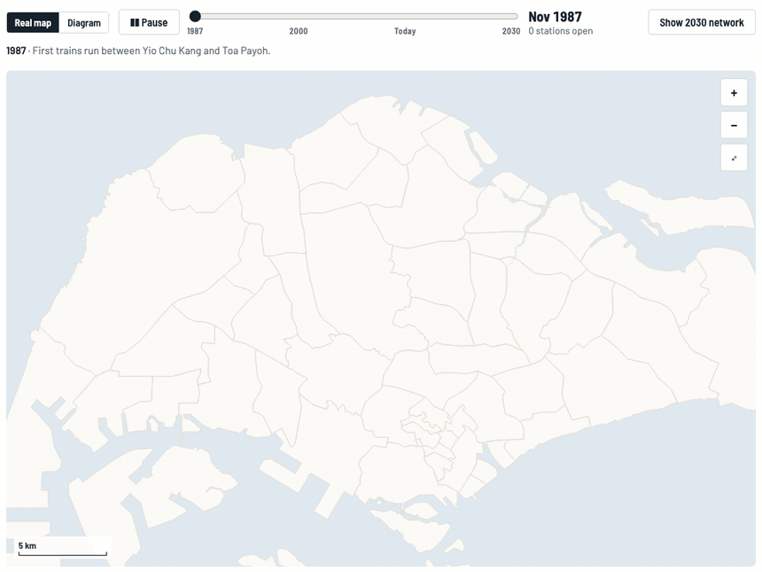

<div align="center">

# 🚇 Singapore MRT, drawn to scale

### The official map is a diagram. This one isn't.

Every MRT and LRT line and station at its real position on the island,<br>
so you can see what the diagram bends. Plus fun facts, 1987–2030 history and a connectivity score.

<br>

[](https://fang89.github.io/Singapore-MRT-facts/)

**👉 [fang89.github.io/Singapore-MRT-facts/](https://fang89.github.io/Singapore-MRT-facts/)**

<br>


<br>

<a href="https://fang89.github.io/Singapore-MRT-facts/"><picture><source media="(prefers-color-scheme: dark)" srcset="docs/screenshots/history-dark.gif"></picture></a>

<sub>Press ▶ Play on the live map: 1987 to today, one line stage at a time.</sub>

</div>

---

## ✅ The verdict

| | | |
|:-:|---|---|
| ✅ | **Accurate for routing** | Station order, line colours and interchanges on the official map are correct. Use it to plan a journey. |
| ❌ | **Not accurate as geography** | Gaps between stations range **0.4–4.2 km** but are drawn nearly equal, and lines are straightened to 45° angles. |

## 🧭 Where the map bends reality

| | | |
|:-:|---|---|
| 📏 | **Downtown stops are 400 m apart; suburban ones up to 4.2 km** | Outram Park–Maxwell is 0.42 km, Khatib–Yio Chu Kang 4.17 km. The diagram draws both about the same length. |
| 🏙️ | **The CBD is enlarged many times over** | Over 30 stations crowd into roughly 3 km by 3 km. Interchanges that look far apart are a short walk at street level. |
| ⭕ | **The Circle Line is not a circle** | It's a lopsided ring: a long arc through the north-central suburbs and a short southern side via HarbourFront, Keppel and Prince Edward Road. |
| ↪️ | **The North South Line swings far west** | From Jurong East it heads north through Bukit Batok and Choa Chu Kang before turning east at Kranji. Jurong East to Woodlands is 12.6 km. |
| ✈️ | **Expo to Changi Airport is one long hop** | 3.8 km between the branch's two stops, one of the longest gaps on the network, drawn as a short stub. |
| ↔️ | **Pasir Ris to Tuas Link is 35 km** | The East West Line spans the island; its Jurong end has 1.3–2.4 km gaps the diagram compresses. |

## 🎉 Fun facts

| | | |
|:-:|---|---|
| **220 m** | **Closest two stations** | Bencoolen (Downtown) and Bras Basah (Circle) are 220 m apart with no interchange. Walking beats transferring. |
| **39 km** | **Farthest apart** | Changi Airport to Tuas Link, end to end, in a straight line. |
| **3** | **Triple interchanges** | Dhoby Ghaut, Outram Park and Marina Bay are the only MRT stations served by three lines. |
| **4** | **Ends of the compass** | Sembawang is the northernmost station, HarbourFront the southernmost, Changi Airport the easternmost and Tuas Link the westernmost. |
| **2.5 km** | **Loneliest stop off the airport branch** | Springleaf's nearest neighbour is 2.5 km away. Only Changi Airport is more isolated, at 3.5 km. |
| **146** | **MRT stations, 29 interchanges** | Plus 38 LRT stops. East West and Downtown tie for the most stations at 35 each. |
| **350 m** | **CBD neighbours** | Downtown and Shenton Way are 350 m apart; Raffles Place and Telok Ayer about 400 m. |
| **Caldecott** | **Centre of gravity** | Average the positions of all 146 MRT stations and you land almost on Caldecott. |
| **2.4 km** | **The Circle Line nearly meets itself** | Its 33 stations stretch over 35 km of stops, yet its two ends, Dhoby Ghaut and Bayfront, are just 2.4 km apart. |
| **41 km** | **The North South Line's big U-turn** | From Jurong East to Marina South Pier it covers 41 km of stops to end up only 15 km from where it started. |
| **96%** | **Straightest line** | The North East Line runs 20.1 km of stops between ends 19.3 km apart. It barely bends. |
| **9** | **Stations within 1 km** | Stand at City Hall and nine other MRT stations are within 1 km of you, the densest spot on the network. |
| **1.09 km** | **Stop-and-go line** | The Downtown Line has the shortest average gap between stops. The North South Line has the longest, at 1.59 km. |
| **3 letters** | **Shortest and longest names** | Ubi is the shortest station name. Gardens by the Bay is the longest, at 18 characters. |

Tap any fact on the live map and it flies to the stations involved.

## 🗺️ What else is on the page

- **Real map ↔ diagram.** Morph between true geography and a schematic layout generated from the network itself.
- **Timeline, 1987–2030.** Scrub or play the network's growth, then jump ahead to the planned Jurong Region and Cross Island Lines.
- **Station cards.** Codes, opening years, distance to the next stops and a Google Maps link.
- **Connectivity score.** Choose destinations and weights and every station gets a 0–100 score from travel time, with a 5-minute penalty per line change and walking links under 600 m.

---

## 🛠️ For contributors

### Repo layout

```
index.html           # the whole app: map data, styles and code in one file
docs/screenshots/    # images used in this README
```

### Run locally

```bash
python3 -m http.server 8000   # then open http://localhost:8000
```

### Deploy (free)

**GitHub Pages**: repo Settings → Pages → "Deploy from a branch" → branch `main`, folder `/` (root).
No build step.

## 📚 Sources & licences

- Line and station positions: [sgraildata](https://github.com/cheeaun/sgraildata), OpenStreetMap-derived
  (© OpenStreetMap contributors, [ODbL](https://opendatacommons.org/licenses/odbl/))
- Coastline and planning areas: public URA boundaries
- Future station positions: URA Master Plan 2019 rail station layer
- Opening dates: LTA's line stages as listed on Wikipedia. Planned dates are LTA's latest targets and may change.
- Distances are straight-line between platforms.

Independent project: not an LTA or SMRT product. Line colours follow the network's standard colours.
